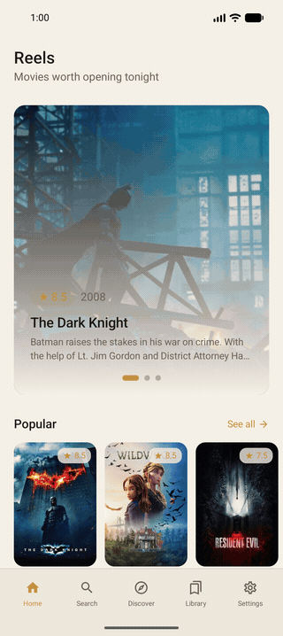
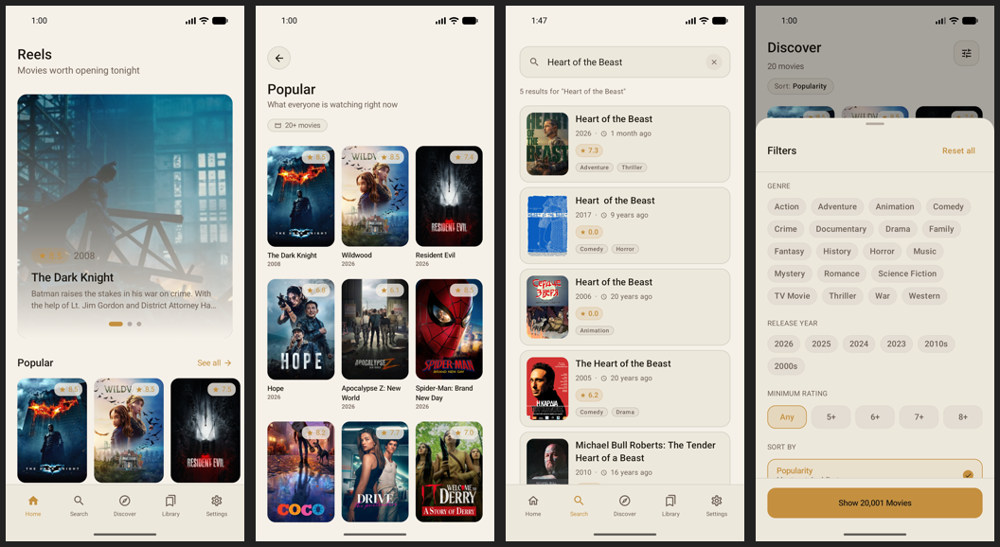
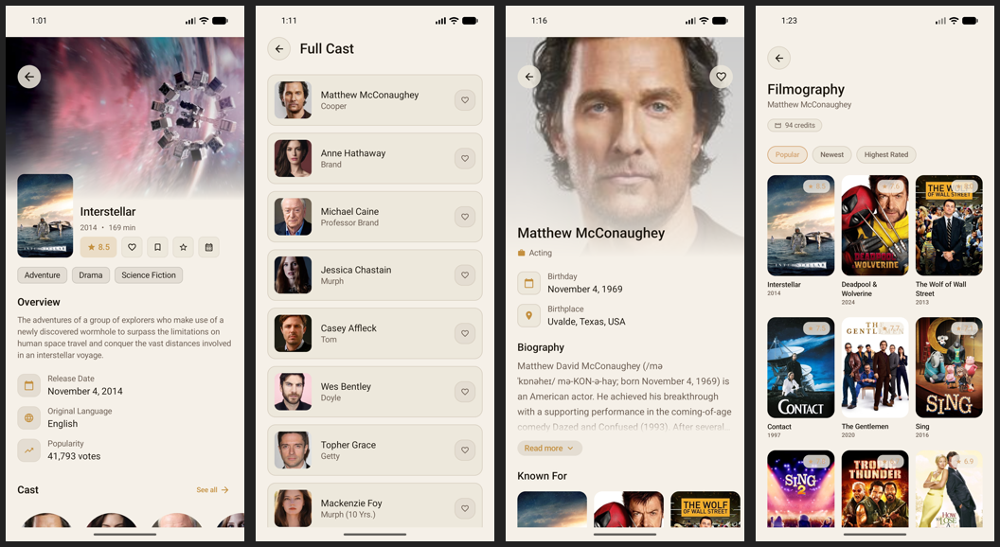
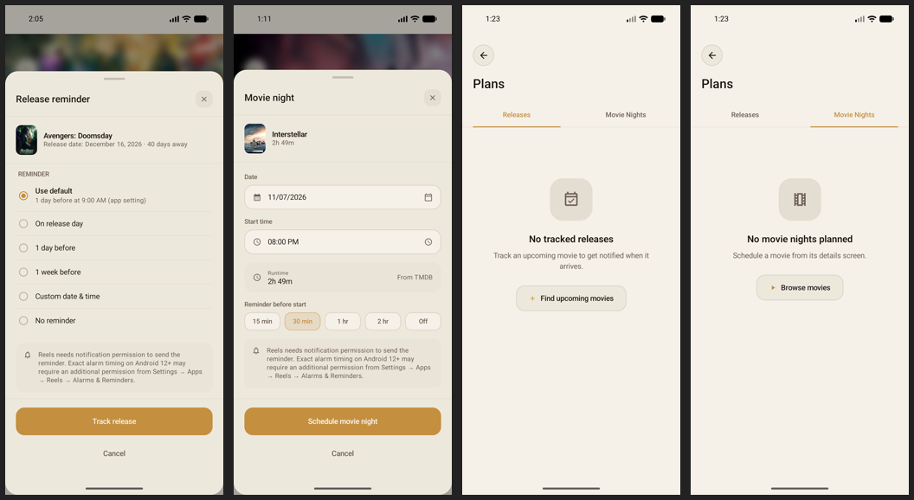
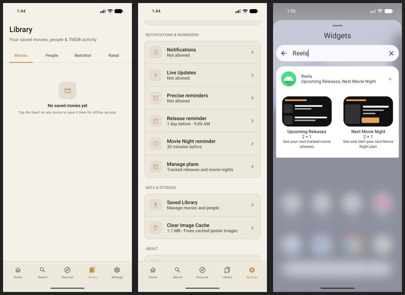
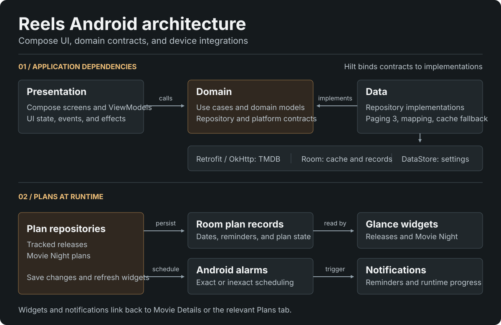

# Reels

<p align="center">
  
  
  
  
</p>

<p align="center">
  Reels is an Android app for discovering movies, tracking upcoming releases, and planning movie nights. Movie data is powered by The Movie Database (TMDB).
</p>

## Demo

<p align="center">
  
</p>

## Screenshots

Captured in Reels on a Pixel 10a emulator.

### Discovery



### Movies and Cast



### Release Tracking and Movie Nights



### Library, Settings, and Widgets



## Download

No prebuilt APK is currently available on [GitHub Releases](https://github.com/NorbertoTaveras/android_reels/releases). To try Reels, follow [Setup](#setup), then build the Production debug APK locally:

```bash
cd Reels
./gradlew :app:assembleProductionDebug
```

## About

- **Browse and discover:** Explore featured movies and paged category grids, filter Discover by genre, year, and rating, or search for movies.
- **Movie and cast details:** See trailers, similar movies, full casts, and person filmographies.
- **Library:** Save movies and people locally. Connect a TMDB account to manage your TMDB watchlist and ratings.
- **Release Tracking:** Follow upcoming movies, set reminders, and see release-date changes as fresh TMDB data becomes available.
- **Movie Nights:** Schedule a movie, set a reminder, and start, pause, resume, or finish a runtime timer. The timer starts only when you choose to start it.
- **Home-screen widgets:** Add Upcoming Releases and Next Movie Night for quick access to your plans.

Release Tracking, Movie Nights, and their widgets work without TMDB sign-in.

## Project Structure

The Android project lives in the [Reels](Reels) directory.

```text
android_reels/
└── Reels/
    ├── app/
    ├── docs/
    ├── gradle/
    ├── build.gradle.kts
    └── settings.gradle.kts
```

## Setup

Create or update `Reels/local.properties` and add your TMDB API read access token:

```properties
TMDB_READ_TOKEN=your_tmdb_v4_read_access_token
```

The token can also be supplied as an environment variable or Gradle property named `TMDB_READ_TOKEN`. Do not commit real API tokens.

You can use [Reels/local.properties.example](Reels/local.properties.example) as the local configuration template.

## Build

From the Android project directory:

```bash
cd Reels
```

Build variants:

- `stageDebug`: debuggable Reels Stage build with a separate application ID.
- `stageRelease`: minified and resource-shrunk Stage build for release QA.
- `productionDebug`: production application id with debug signing.
- `productionRelease`: minified and resource-shrunk release build.

Common local commands:

```bash
./gradlew :app:assembleProductionDebug
./gradlew :app:installProductionDebug
./gradlew :app:assembleProductionRelease
```

Release variants are built unsigned by default. Before signing for distribution, review the [release checklist](Reels/docs/release-checklist.md).

## Tech Stack & Libraries

- Minimum SDK 23 (Android 6.0), target SDK 36, and compile SDK 37.
- [Kotlin](https://kotlinlang.org/) with [Coroutines](https://kotlinlang.org/docs/coroutines-overview.html) and Flow for asynchronous work and reactive streams.
- Jetpack libraries:
  - Jetpack Compose for declarative UI.
  - Material 3 for the app design system.
  - Lifecycle and ViewModel for lifecycle-aware UI state.
  - Navigation Compose for screen navigation.
  - Paging 3 for paged movie lists and search results.
  - Room for saved movies and people, tracked releases, Movie Night plans, and offline response caching.
  - DataStore for app preferences.
  - Glance and Android App Widgets for Upcoming Releases and Next Movie Night.
- Android alarm and notification APIs for reminders and Movie Night progress. Eligible Android 16+ devices can show promoted Live Updates; older devices use standard notifications.
- [Hilt](https://dagger.dev/hilt/) for dependency injection.
- [Retrofit](https://square.github.io/retrofit/) and OkHttp for TMDB networking.
- [Coil](https://coil-kt.github.io/coil/) for poster, backdrop, profile, and trailer image loading.
- KSP for annotation processing.
- The [Gradle version catalog](Reels/gradle/libs.versions.toml) is the source of truth for dependency versions.

## Architecture

<p align="center">
  
</p>

Reels uses MVVM with MVI-inspired input/output discipline inside each screen:

- UI state is exposed as immutable screen state.
- User interactions are sent to ViewModels as events.
- One-off work such as navigation and snackbars is exposed as effects.
- ViewModels coordinate use cases and keep Compose screens focused on rendering.

Package structure:

- `presentation`: Compose screens, UI state, events, effects, ViewModels, navigation, theme, and reusable UI components.
- `domain`: app-facing models, repository contracts, and use cases.
- `data`: Retrofit services, DTOs, Room entities/DAOs, repository implementations, paging sources, preferences, and mappers.
- `di`: Hilt modules and qualifiers.

This keeps TMDB DTOs, Room entities, domain models, and UI models from leaking across layers.

Room-backed release and Movie Night plans feed the Plans screen and Glance widgets. Plan changes also update Android alarm schedules and notifications through domain interfaces.

## Data & Offline Behavior

Reels is online-first. It prefers fresh TMDB responses and falls back to previously cached data in Room when connectivity is unavailable or a request fails. Saved movies and people, tracked releases, and Movie Night plans are stored locally, independently of the TMDB response cache.

Current offline scope:

- Home categories, Search, Discover results, trending movies, and category pagination.
- Movie details, full cast, trailer listings, and similar movies after they have been loaded once. Trailer playback still requires a connection.
- Person details and complete filmography after they have been loaded once.
- TMDB watchlist, rated movies, and per-movie account state for the connected account.
- Movie genres used by Discover filters.
- Favorite movies and saved people, including their offline detail fallback.

Actions that modify TMDB data, including watchlist and rating changes, still require a network connection. Cached account data is scoped by TMDB account ID and is never exposed while no account is connected.

## Open API

<p align="center">
  
</p>

Reels uses [The Movie Database API](https://developer.themoviedb.org/reference/intro/getting-started) for movie data, including popular movies, now playing movies, upcoming movies, top rated movies, movie search, movie details, credits, videos, similar movies, and person details.

This product uses the TMDB API but is not endorsed or certified by TMDB. See TMDB's [logos and attribution guidance](https://www.themoviedb.org/about/logos-attribution).

## Production Readiness

The app includes:

- Stage and production product flavors.
- Release minification and resource shrinking.
- API token configuration outside source control.
- Network logging disabled in release.
- Cleartext traffic disabled.
- Loading, empty, error, retry, and offline states where applicable.
- Light and dark Material 3 themes.

## License

Designed and developed by [Norberto Taveras](https://github.com/NorbertoTaveras).

Copyright (c) 2026 Norberto Taveras. All rights reserved.

This project is proprietary. The source code, documentation, design assets, and project structure may not be copied, modified, distributed, sublicensed, published, or incorporated into another project without prior written permission.

This product uses the TMDB API but is not endorsed or certified by TMDB. Movie data, images, logos, trademarks, and other third-party materials remain subject to their respective owners' terms, licenses, and attribution requirements.

See [LICENSE](LICENSE) for details.
