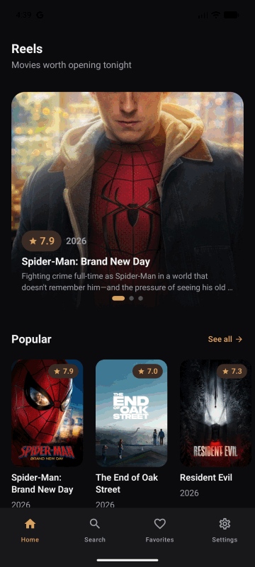

# Reels

<p align="center">
  
  
  
  
</p>

<p align="center">
  Reels is a movies-first Android app powered by The Movie Database API. It demonstrates production-minded Android development with Kotlin, Jetpack Compose, Material 3, Hilt, Retrofit/OkHttp, Paging, Room, Coroutines, Flow, and MVVM with unidirectional UI state and events.
</p>

## Demo

<p align="center">
  
</p>

<p align="center">
  <a href="docs/assets/reels-demo.gif">View the Reels demo GIF</a>
</p>

## About

Reels focuses on a polished movie browsing experience inspired by premium streaming and movie discovery apps. The v1 experience includes browsing movie categories, search, movie details, cast details, trailers, favorites, settings, offline favorite access, and release-ready app configuration.

Core screens:

- Home with featured movies and poster carousels.
- See All category screens with paged movie grids.
- Search with recent searches, paged results, ratings, and genres.
- Movie Details with metadata, genres, cast, trailers, similar movies, and favorite actions.
- Full Cast and Cast Details screens.
- Favorites with offline availability.
- Settings with preferences, local storage actions, app info, privacy, and TMDB attribution.

## Setup

Create or update `local.properties` at the project root and add your TMDB API read access token:

```properties
TMDB_READ_TOKEN=your_tmdb_v4_read_access_token
```

The token can also be supplied as an environment variable or Gradle property named `TMDB_READ_TOKEN`. Do not commit real API tokens.

You can use [local.properties.example](local.properties.example) as the local configuration template.

## Build

Build variants:

- `stageDebug`: stage application id and stage app name.
- `productionDebug`: production application id with debug signing.
- `productionRelease`: minified and resource-shrunk release build.

Common local commands:

```bash
./gradlew :app:assembleProductionDebug
./gradlew :app:installProductionDebug
./gradlew :app:assembleProductionRelease
```

Before preparing a signed build, review the [release checklist](docs/release-checklist.md).

## Tech Stack & Libraries

- Minimum SDK level 23.
- [Kotlin](https://kotlinlang.org/) with [Coroutines](https://kotlinlang.org/docs/coroutines-overview.html) and Flow for asynchronous work and reactive streams.
- Jetpack libraries:
  - Jetpack Compose for declarative UI.
  - Material 3 for the app design system.
  - Lifecycle and ViewModel for lifecycle-aware UI state.
  - Navigation Compose for screen navigation.
  - Paging 3 for paged movie lists and search results.
  - Room for local favorite movie storage.
  - DataStore for app preferences.
- [Hilt](https://dagger.dev/hilt/) for dependency injection.
- [Retrofit](https://square.github.io/retrofit/) and OkHttp for TMDB networking.
- [Coil](https://coil-kt.github.io/coil/) for poster, backdrop, profile, and trailer image loading.
- KSP for annotation processing.
- Gradle version catalogs for dependency management.

## Architecture

Reels uses MVVM with MVI-inspired input/output discipline inside each screen:

- UI state is exposed as immutable screen state.
- User interactions are sent to ViewModels as events.
- One-off work such as navigation and snackbars is exposed as effects.
- ViewModels coordinate use cases and keep Compose screens focused on rendering.

Package structure:

- `presentation`: Compose screens, UI state, events, effects, ViewModels, navigation, theme, and reusable UI components.
- `domain`: app-facing models, repository contracts, and use cases.
- `data`: Retrofit services, DTOs, Room entities/DAOs, repository implementations, paging sources, preferences, and mappers.
- `di`: Hilt modules and qualifiers.

This keeps TMDB DTOs, Room entities, domain models, and UI models from leaking across layers.

## Data & Offline Behavior

Reels is online-first for browse, search, details, cast, trailers, and similar movies. Favorites are stored locally with Room so saved movies remain available offline.

Current offline scope:

- Favorite movie list renders from local storage.
- Movie details can fall back to locally saved favorite data when network details fail.
- Full browse/search response caching is intentionally left outside v1.

## TMDB API

Reels uses [The Movie Database API](https://developer.themoviedb.org/reference/intro/getting-started) for movie data, including popular movies, now playing movies, upcoming movies, top rated movies, movie search, movie details, credits, videos, similar movies, and person details.

This product uses the TMDB API but is not endorsed or certified by TMDB.

## Production Readiness

The app includes:

- Stage and production product flavors.
- Release minification and resource shrinking.
- API token configuration outside source control.
- Network logging disabled in release.
- Cleartext traffic disabled.
- Loading, empty, error, retry, and offline states where applicable.
- Light and dark Material 3 themes.

See [release-checklist.md](docs/release-checklist.md) before creating a signed release artifact.
